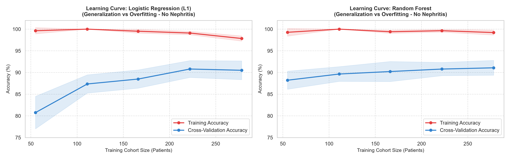

# SLE diagnosis from clinical signs

My graduation project at FCAI, Cairo University (supervised by Dr. Sara).

The question: can we tell whether a patient has Systemic Lupus Erythematosus using only
clinical signs and symptoms, before lab results are available?

The dataset is 436 patients (218 SLE, 218 non-SLE) with 76 clinical features. It contains
real patient records, so it is **not** included here. The notebooks are shared to show the
approach and results.

## Approach

- 80/20 stratified split, 5-fold stratified CV on the training set
- Compared logistic regression (L1 and L2), random forest, extra trees,
  HistGradientBoosting, SVM and KNN
- Checked overfitting with the train/test gap and learning curves
- Used the L1 logistic regression coefficients to build a simple points-based
  scoring sheet that a clinician could use by hand
- Second notebook repeats the experiment with lupus nephritis added as a feature

## Results (test set, 88 patients)

| Model | CV acc. | Test acc. | Sensitivity | Specificity | AUC |
|---|---|---|---|---|---|
| Logistic regression (L1) | 90.5% | 93.2% | 88.6% | 97.7% | 0.980 |
| Random forest | 91.1% | 93.2% | 86.4% | 100% | 0.981 |
| HistGradientBoosting | 90.5% | 93.2% | 88.6% | 97.7% | 0.970 |
| Extra trees | 91.4% | 92.0% | 84.1% | 100% | 0.983 |
| SVM | 89.4% | 88.6% | 90.9% | 86.4% | 0.965 |

The L1 model matches the tree models on test accuracy with the smallest train/test gap
(4.2%), and it keeps only 47 of the 76 features, which is what the scoring sheet is
built from.

## Files

- `notebooks/sle_clinical_signs_model.ipynb`: main experiment
- `notebooks/sle_with_nephritis_model.ipynb`: nephritis variant
- `figures/`: learning curves
